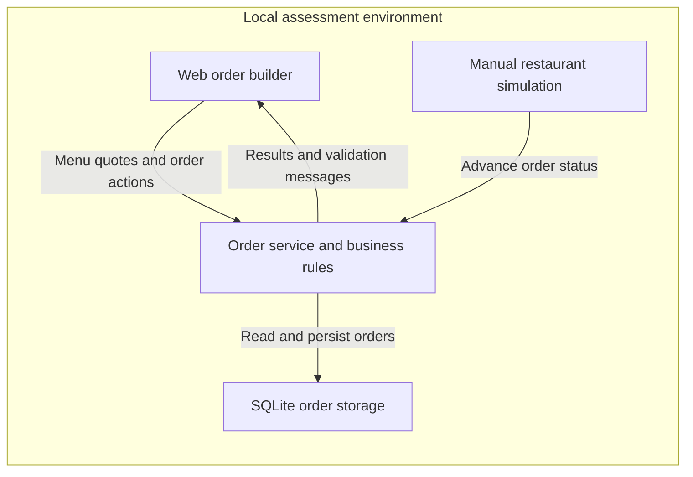
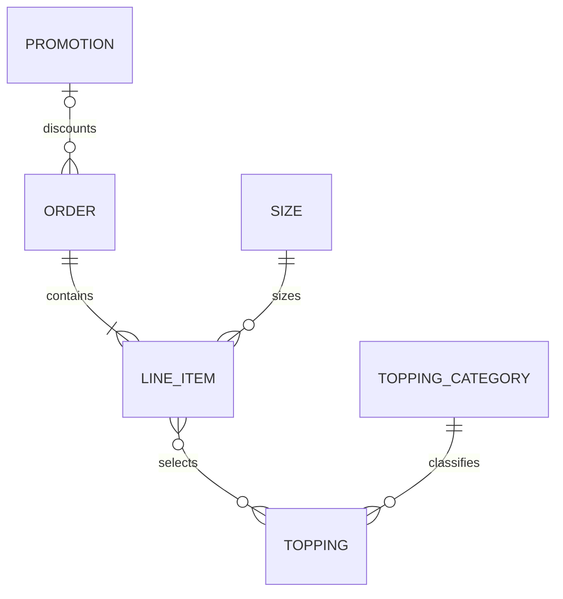
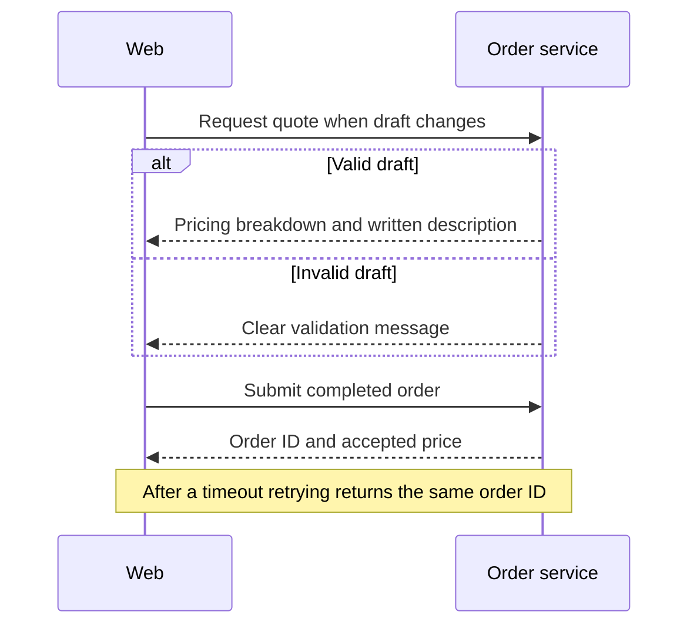

# Pizza-Driven Development - High-Level Design

## 1. Overview

An anonymous customer builds, prices, submits, and tracks a pizza order, with changes or cancellation allowed until kitchen start. This is a local interview assessment, not a production website.

Retain the existing stack. **All business logic belongs to the API; the web stays thin.** Business rules and approved assumptions remain in [pizza-requirements.md](pizza-requirements.md), subject to the original assessment brief.

## 2. Architecture Summary

The web and API run separately and communicate over HTTP with JSON.

## 3. Core Components

| Component | Responsibility and ownership |
|-----------|------------------------------|
| Web order builder | Holds the draft, sends actions, and displays API-provided prices, descriptions, statuses, and validation messages. |
| Order service | Owns validation, pricing, menu/promo rules, descriptions, retry handling, and order lifecycle. |
| SQLite | Persists accepted orders, prices, statuses, and submission retry information. Only the API accesses it. |
| Restaurant simulation | A manual API operation advances status; no restaurant UI or timer. |

## 4. Data Models

Sizes carry base prices; categories carry topping percentages; toppings belong to categories. Line items select a size, quantity, and toppings. Orders hold their line items, tip choice, optional promo, accepted pricing, and status. Promotions define discounts, eligibility, and conflicts.

Drafts and quotes are not persisted orders. Before submission, Save Changes updates only the browser draft; Submit Order creates the persisted order visible to the restaurant. Submitted orders retain their accepted contents and prices until the API accepts an update while Not Started. Cancellation preserves a queryable outcome. These are logical concepts, not a database schema.

## 5. Data Flows

The web first loads the API's menu. Quotes and accepted orders use the same pricing rules; menu prices and promo rules are assumed fixed during ordering. Pending or failed quotes are shown as such, never replaced by browser estimates or stale totals.

Customers request status and may update or cancel only while **Not Started**. Manual restaurant actions advance **Not Started -> Started -> Ready for Pickup -> Delivered**. Cancellation is terminal. When cancellation races kitchen start, the first successful change wins and the other is rejected; updates cannot bypass kitchen start either.

Validation failures leave the order unchanged. Timeouts do not imply submission failed: retrying the same submission attempt must not create a duplicate, including across an API restart. A deliberate new submission is a new order even if its contents are identical.

## 6. Key Design Decisions

| Decision | Rationale | Alternative not selected |
|----------|-----------|--------------------------|
| API-owned business logic | One source of truth for every customer action. | Browser duplication risks disagreement. |
| Integer cents and exact decimal percentage calculations | Exact money handling with the approved rounding rules. | Binary floating point is unsuitable; decimal dollars are viable but not selected. |
| Data-driven menu and separate promo-specific rules | New menu data or promo behavior leaves core pricing unchanged. | Scattered constants hinder extension; a general rule engine adds scope. |
| Persistent, atomic order changes | Supports safe retries and competing lifecycle actions. | In-memory storage loses orders on restart. |
| Manual restaurant advancement | Simple, controllable demonstration. | Timers add unnecessary timing concerns. |

## 7. Security Architecture

Anonymous access is intentional: no authentication or customer ownership checks, including for restaurant simulation. This is unsuitable for public exposure.

The API treats browser input as untrusted and enforces all business rules; the browser cannot dictate prices or status. SQLite remains local to the service. Local HTTP and an unencrypted database are sufficient; no payment or account information is collected.

## 8. Deployment Model

Run the existing web development server and API as separate local processes, with SQLite in the repository's runtime data folder. Retain the existing API proxy and GitHub Actions build/test jobs. No production environment or additional infrastructure is designed.

## 9. Technology Choices

| Area | Choice | Reason |
|------|--------|--------|
| Web | React 19, TypeScript, Vite 8 | Retain the existing thin-client scaffold. |
| Service | C#, ASP.NET Core Minimal API, .NET 10 | Retain the existing business-logic host. |
| Communication | HTTP and JSON | Simple request/response operations. |
| Persistence | SQLite, Microsoft.Data.Sqlite, handwritten SQL | Local durability and atomic changes without infrastructure. |
| Tests | NUnit and Vitest | Existing tools; prioritize pricing, retry, and lifecycle invariants. |

## 10. What This Design Defers

No accounts, payments, real kitchen/delivery integration, menu administration, or multiple locations. Also omit production deployment, visual polish, offline pricing, queues, and live notifications.

The LLD covers contracts, data representation, retry/concurrency mechanisms, and concrete tests. The README, short assessment write-up, and AI usage note remain required; this HLD does not replace them.

## 11. Open Questions

None at the architectural level. API ownership, integer cents, and manual restaurant advancement are confirmed; implementation choices remain for the LLD.
