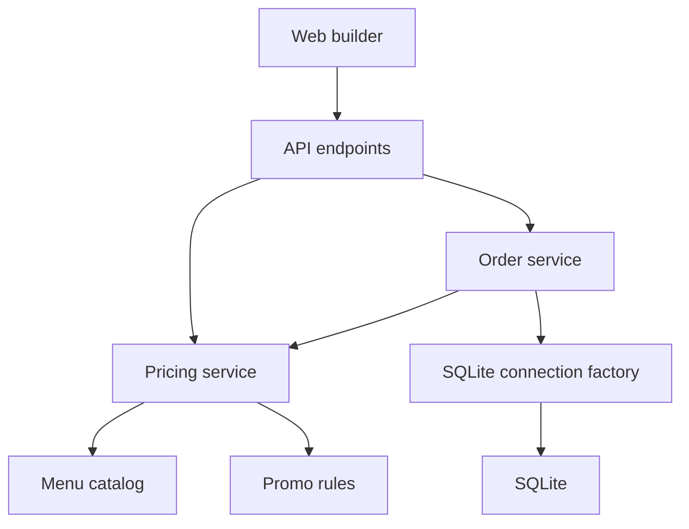
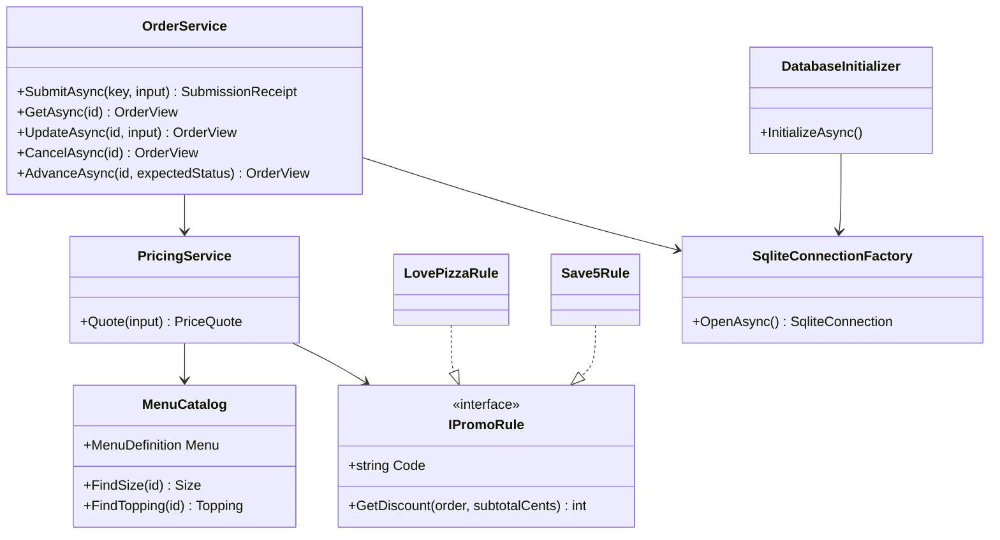
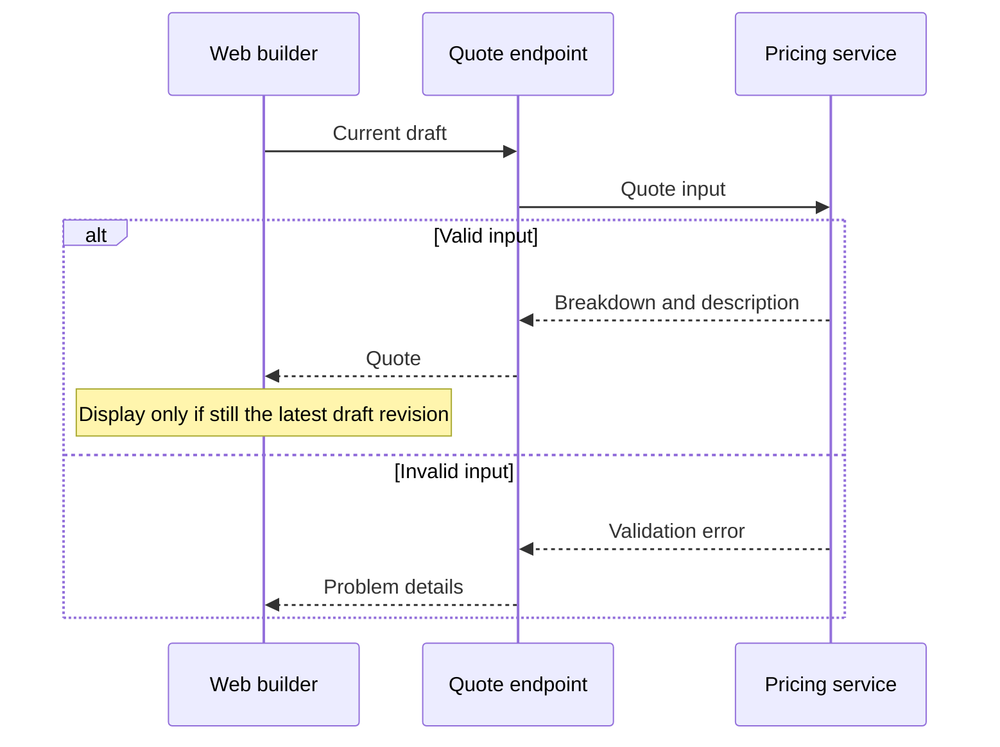
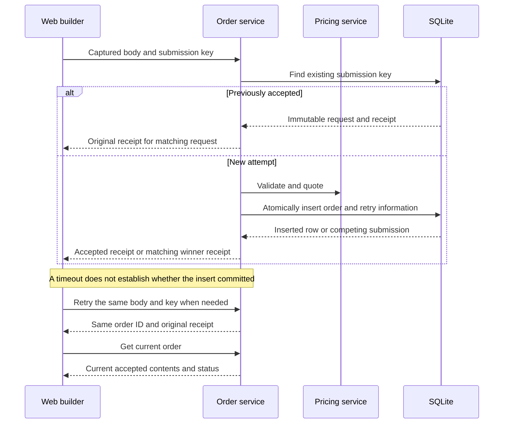
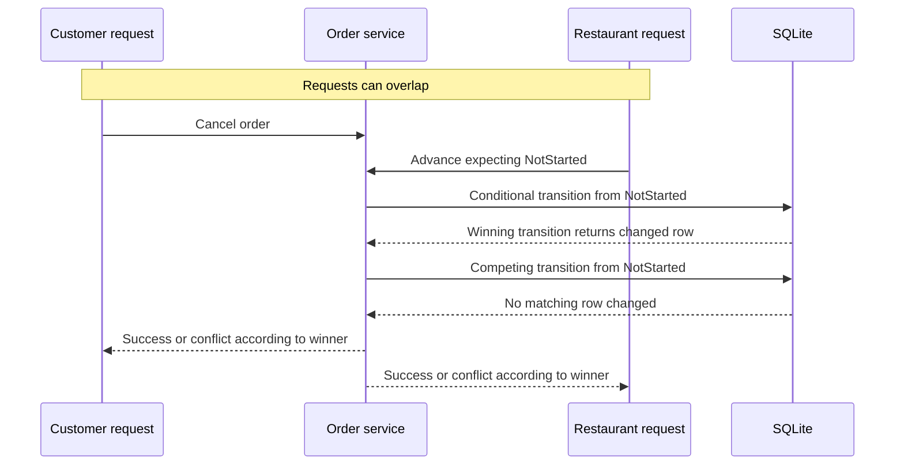
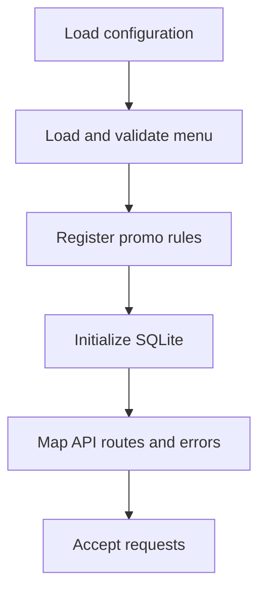

# Pizza-Driven Development - Low-Level Design

## 1. Overview

Implement the [requirements](pizza-requirements.md) within the existing [high-level design](pizza-high-level-design.md): a thin React builder, an ASP.NET Core API owning all business rules, and local SQLite. This is an interview exercise, not a production system. Detail is concentrated on exact pricing, retry safety, and atomic lifecycle changes.

Keep the two existing application projects and existing test projects. No domain library, generic repository, event bus, mapping framework, or new infrastructure. This document specifies contracts and tests, not implementation code or completed functionality.

### 1.1 Assumptions and Deliberate Limits

The requirements document's confirmed assumptions remain authoritative, including tip/tax bases, rounding, exact promo-code matching, fixed menu definitions, and terminal cancellation. Also record these decisions in the final README:

| Area | Decision |
|------|----------|
| Promo combinations | **One optional promo code per order.** All promos are mutually exclusive by construction, including SAVE5 and ILOVEPIZZA. A new promo owns its eligibility and discount rule; supporting combinations of future promos is outside this version. |
| Submission timeout | Preserve an immutable submission attempt and disable edits/new submissions until its outcome is recovered. Retry resends that attempt. Once recovered, normal update/cancel remains available while Not Started. |
| Browser lifetime | Drafts and pending attempts live in the current page, not browser storage. Recovery after page reload or closing the browser is not promised. API restart does not lose an accepted submission or its retry information. |
| Concurrent edits | No multi-editor merge or version protocol. Among updates accepted while Not Started, the last database write wins. Updates, cancellation, and kitchen start still compete atomically. |
| Input interpretation | Quantity is a positive integer. A topping is selected at most once per line; repeated topping IDs are invalid rather than extra portions. No promo is represented by a missing/null code, not an empty or whitespace code. |
| Numeric capacity | Money is nonnegative 32-bit integer cents; quantity is a positive 32-bit integer. Reject unrepresentable inputs or calculation overflow clearly. There is no arbitrary tip percentage cap; limits arise only from numeric capacity. |

The first two decisions were explicitly confirmed during this design discussion. The remaining implementation limits must be visible in the README, not hidden guarantees.

## 2. Package/Module Structure

### 2.1 Dependency Graph

These are folders/types within the existing projects, not additional packages or layers.

### 2.2 Files and Responsibilities

| Location | Purpose and public surface | Internal dependencies |
|----------|----------------------------|-----------------------|
| `src\pdd-api\Program.cs` | Composition root, small `/api` route handlers, HTTP error mapping. Keep route handlers free of pricing/SQL. | Services, models, existing data initialization. |
| `src\pdd-api\Models\` | Plain records/enums for menu, order input, quote, receipt, order view, and expected business errors. Group related records; not one file per trivial DTO. | None. |
| `src\pdd-api\menu.json` | Size prices, topping names, category memberships, category percentages. | None. |
| `src\pdd-api\Services\MenuCatalog.cs` | Load/validate the menu once; expose stable menu data and ID lookups. | Menu records. |
| `src\pdd-api\Services\PricingService.cs` | Validate an order, produce its exact price breakdown and description through `Quote(OrderInput)`. | MenuCatalog and registered promo rules. |
| `src\pdd-api\Services\PromoRules.cs` | Small `IPromoRule` contract and the two concrete rules. No combination engine. | Expected validation error type. |
| `src\pdd-api\Services\OrderService.cs` | Submit, get, replace, cancel, advance; own handwritten order SQL and retry comparisons. | PricingService, SqliteConnectionFactory, models. |
| `src\pdd-api\Data\` | Retain connection factory and initializer; extend the embedded, idempotent `schema.sql`. | Microsoft.Data.Sqlite. |
| `src\pdd-web\client\App.tsx` | Form, current draft/quote, submitted order, action state, and quote-response ordering. Extract markup only if readability requires it. | API helper and TS contracts. |
| `src\pdd-web\client\api.ts` | Typed fetch calls, timeout/error handling, creation and resending of an immutable submission attempt. | TS contracts and browser fetch. |
| `src\pdd-web\client\types.ts` | Small handwritten HTTP contracts. No shared-runtime domain implementation or generated client. | None. |
| `tests\pdd-api\`, `tests\pdd-web\` | Focused tests described in section 8; retain existing runners/configuration. | Application code and existing test tools. |

Root namespaces remain `PDD.API` and its subnamespaces. Use concrete constructor-injected services. `IPromoRule` earns its place because a new conditional promo must not change the pricing algorithm; other services need no interface just for mocking.

## 3. Types and Class Diagrams

### 3.1 API Collaborators

All asynchronous order methods return tasks and accept a cancellation token. Missing menu IDs and ineligible promos become validation errors, not null-dependent arithmetic.

`IPromoRule.GetDiscount(OrderInput order, int subtotalCents)` receives the already validated order input and its undiscounted food subtotal. The rule may inspect selected sizes, quantities, and toppings, but must not mutate the input or recalculate its subtotal. It owns eligibility checks and returns the rounded discount in cents, or raises a validation error when ineligible. The two existing rules use only the subtotal; new order-dependent rules use the same contract.

### 3.2 Data Contracts

| Type | Fields and constraints |
|------|------------------------|
| `MenuDefinition` | Sizes: stable string ID, display name, positive base price in cents. Categories: ID and nonnegative decimal percentage. Toppings: ID, name, category ID. IDs must be unique within each collection; references must exist. |
| `OrderInput` | Nonempty ordered `items`, `tip`, optional `promoCode`. No client-supplied price, description, or status is authoritative. |
| `LineItemInput` | `sizeId`, positive integer `quantity`, distinct `toppingIds` (empty allowed). Line order is retained. |
| `TipInput` | `mode`: `dollars` or `percent`; `value`: decimal **string**. WEB preserves the input text; API parses using invariant culture and decimal arithmetic, never a binary float. Initial UI value is `"0"`. |
| `PriceQuote` | Ordered priced lines, `subtotalCents`, `discountCents`, `taxableSubtotalCents`, `taxCents`, `tipCents`, `totalCents`, and server-generated `description`. Each priced line includes size/topping names, component cents, unit cents, quantity, and line-total cents. |
| `SubmissionReceipt` | `orderId` and the original accepted `quote`. Immutable across retries; not a current-status response. |
| `OrderView` | `orderId`, `status`, current accepted `order` input, and current accepted `quote`. |
| `OrderStatus` | Wire values `NotStarted`, `Started`, `ReadyForPickup`, `Delivered`, `Cancelled`; UI displays the brief's human-readable labels. |
| WEB `SubmissionAttempt` | Readonly key and serialized request body, captured once at Submit. Subsequent retries reuse both, not the editable draft. |

Use camelCase JSON, GUID order IDs and retry keys, integer JSON money fields, and string enum values. All cent values fit safely in JavaScript integers. WEB formats server-provided cents as dollars with two decimal places; it never recalculates charges.

### 3.3 Exact Pricing Contract

`PricingService.Quote` is the only calculation path used by quotes, submission, and updates (FR-2, FR-5). It is deterministic and does not persist anything.

1. Validate the order structure, known menu IDs, quantity, distinct toppings, tip mode/value, and exact promo-code match. Reject negative, nonnumeric, missing, or unrepresentable tip values clearly.
2. For each topping, apply its category percentage to that size's base cents and round to an integer cent. Add these charges to base cents, then multiply the pizza's unit price by quantity.
3. Sum line totals to the undiscounted food subtotal.
4. If selected, resolve one registered promo by its exact code and pass the validated `OrderInput` and undiscounted food subtotal to `GetDiscount`. `LovePizzaRule` rounds 10% of subtotal; `Save5Rule` requires subtotal strictly above 2,000 cents and discounts 500 cents. An ineligible code is an error, not silently ignored.
5. Subtract the rounded discount. Calculate and round 6.5% tax on this discounted subtotal.
6. For a percentage tip, calculate and round the percentage of the discounted subtotal before tax. For a dollar tip, convert its decimal dollars to rounded cents.
7. Add discounted subtotal, rounded tax, and rounded tip. Build the description from the same resolved lines, explicitly describing a pizza with no toppings.

All rounding is nearest cent with midpoint away from zero, equivalent to halfway up for permitted nonnegative amounts. Use decimal intermediates and checked integer conversions/addition/multiplication. Do not truncate, use binary floating point, or round only the grand total. Rule outputs must stay between zero and subtotal; an invalid registered rule is a programming/configuration error, not a discount to silently clamp.

Adding sizes, toppings, or categories changes only menu data. Adding a promo adds/registers one rule with its own eligibility logic, including conditions on the order contents; the pricing call site and algorithm remain unchanged. One-code input means all promos conflict structurally. A future requirement for combinable promos would deliberately revisit that assumption, not be claimed as already supported (FR-11, FR-12).

## 4. Interactions and HTTP Surface

### 4.1 Endpoints

| Method and route | Request | Success and meaning |
|------------------|---------|---------------------|
| `GET /api/menu` | None. | 200 menu data. |
| `POST /api/quote` | `OrderInput`. | 200 `PriceQuote`; no draft/order persistence. |
| `POST /api/orders` | `OrderInput`; required `Idempotency-Key` header containing a GUID. | 201 `SubmissionReceipt`, including on a matching replay; `Location` identifies the order lookup. |
| `GET /api/orders/{id}` | None. | 200 current `OrderView`, including Cancelled. |
| `PUT /api/orders/{id}` | Complete replacement `OrderInput`. | 200 updated `OrderView`, only while NotStarted. |
| `POST /api/orders/{id}/cancel` | None. | 200 Cancelled `OrderView`. Already Cancelled returns the same outcome; other progressed states conflict. |
| `POST /api/orders/{id}/advance` | `expectedStatus`. | 200 next `OrderView` only if current status matches and has a legal next stage. |

Keep the existing health endpoint. Restaurant advancement derives the next stage server-side: NotStarted -> Started -> ReadyForPickup -> Delivered. Cancelled and Delivered are terminal. Requiring `expectedStatus` prevents a repeated manual request from accidentally advancing twice; it does not allow skipping stages. README examples will document this operation; there is no kitchen UI or timer (FR-6 through FR-10).

### 4.2 Editing, Quotes, and Description

Each relevant draft change immediately invalidates the displayed total and requests another quote. Abort obsolete requests and also guard results by draft revision; abort alone is not an ordering guarantee. A pending/failed quote is visibly pending/failed, never a stale total presented as current. Disable submission/update until the current draft has a valid quote. Submission/update still revalidates server-side.

WEB loads the menu, supports adding/removing/editing line items, tip mode/value, and a single optional promo code. A Show Description action displays the current API-generated description, not a second description implementation. Before submission, Save Changes validates/quotes the browser draft only; it does not create a persisted order. After submission, Save Changes calls PUT while the last known status is NotStarted; the server remains authoritative if status changed meanwhile.

Check Status explicitly calls GET; no polling or push notifications. On status conflicts or uncertain update/cancel responses, refresh the accepted order before deciding what actions remain available. Preserve an unsaved draft separately from the accepted order; do not silently discard it on a failed update (FR-1 through FR-4, FR-7, FR-8).

### 4.3 Submission and Timeout Recovery

Capture the serialized input and fresh key only when starting a deliberate submission. Disable editing and additional submissions while its outcome is pending/unknown. A timeout/network failure/5xx retains the attempt and offers Retry Submission; do not generate a new key or say the order failed. An explicit validation rejection permits correction and a fresh attempt. After receiving the receipt, fetch current state before re-enabling applicable actions; the kitchen may already have started.

The server retains the initial request and receipt even after an order update/cancellation. Thus replay cannot overwrite later changes, reprice the order, or claim that the original receipt is current status. Compare requests using the same server serialization of the typed input, preserving line/topping order and tip text; no hashing or semantic-normalization framework is needed. A same-key/different-input request is rejected with 409 as a defensive boundary check; the normal UI never constructs it.

A deliberate new order gets a new key even for identical contents. There is no submission-key expiry/cleanup policy in this version (FR-6, FR-10).

### 4.4 Cancellation or Update Racing Kitchen Start

The database predicate, not an earlier read or an in-process lock, decides permission. Update replaces the snapshot only when status is still NotStarted. A start that commits first prevents later update/cancel; a cancellation that commits first prevents start. If an update wins first, kitchen start may subsequently succeed and must retain the updated contents; those two successes are legal in that order.

## 5. Data Access

### 5.1 One Orders Table

| Column | Storage and contract |
|--------|----------------------|
| `id` | TEXT primary key; GUID. |
| `submission_key` | TEXT, non-null, unique; immutable. |
| `submission_request_json` | TEXT, non-null; immutable typed original input for retry comparison. |
| `submission_receipt_json` | TEXT, non-null; immutable original receipt. |
| `status` | TEXT, non-null; constrained to the five supported values. |
| `order_json` | TEXT, non-null; current accepted input and quote, including resolved names and description. |

Keep ID/status outside JSON to avoid competing sources for lifecycle state. The original receipt and current snapshot intentionally duplicate initial pricing: they diverge when a NotStarted order is updated, and retries must still return the initial receipt.

No line-item tables, timestamps, audit history, foreign keys, or JSON-query indexes are needed. Never reconstruct an accepted price/name from the current menu during GET.

### 5.2 Query and Transaction Boundaries

`OrderService` is the concrete data access boundary; its methods are the API in section 3.1. There is no separate DAO/repository interface.

| Operation | Query pattern and atomicity |
|-----------|-----------------------------|
| Get/replay | Parameterized lookup by primary ID or unique submission key. Return a complete row; absence becomes 404 for order lookup. |
| Submit | Check for replay; otherwise validate/price and insert all six fields in **one statement**. On conflict specifically on submission key, leave the winner untouched, load it, compare request, and return its receipt or 409. Unique insertion handles simultaneous requests, including across service instances. |
| Update | Price before writing, then conditionally replace only `order_json` where ID matches and status is NotStarted. Return the changed row from the write, rather than a later read that might describe a different action. |
| Cancel | Conditionally change NotStarted to Cancelled and return the changed row. If no match, distinguish missing, already Cancelled, and other statuses using a lookup. |
| Advance | Validate the expected state's legal successor; conditionally change status where ID and expected status both match, returning the changed row. |

Each mutation fits a single SQLite atomic statement. No application-level read-then-unconditional-write sequence or long transaction spans pricing/HTTP. If no conditional row changes, a follow-up read distinguishes missing from conflict; it is not what authorizes the write.

### 5.3 Connections and Schema

Retain `SqliteConnectionFactory`, existing content-root-relative database-path resolution, provider pooling defaults, and startup WAL initialization. Open/dispose a connection per operation; never share a live connection across requests. Parameterize every SQL value.

Retain the provider's bounded busy timeout; exhaustion returns a visible retryable service error, not a business conflict or silent success. Do not add an application retry loop or custom thread-pool settings. Thread cancellation through asynchronous calls; cancellation after a committed insert is precisely why submission replay exists.

Extend the existing embedded `schema.sql` with idempotent table creation and constraints. No migration framework or automatic destructive schema reset. Schema evolution after this exercise is deferred; initialization/schema errors fail startup clearly.

## 6. Error Handling

Use one small `OrderException` carrying `Validation`, `NotFound`, or `Conflict` plus a safe message. Pricing/promo/order methods use it for expected business failures; endpoint-boundary handling maps it to Problem Details. It is not a generic result framework or an exception hierarchy per rule.

| Condition | HTTP response and UI handling | Logging |
|-----------|------------------------------|---------|
| Malformed JSON, missing key, invalid IDs/quantity/tip/promo, numeric overflow | 400 Problem Details with an actionable `detail`; no writes. Preserve editable input. | No error-level stack trace for expected input errors. |
| Missing order | 404 Problem Details. | No error-level stack trace. |
| Forbidden transition or submission-key mismatch | 409 Problem Details explaining the conflict. UI refreshes current order state where applicable. | No error-level stack trace. |
| SQLite busy timeout | 503 Problem Details; advise retry/recheck, never report rejection as certain. | Warning with operation context. |
| Unexpected database, stored JSON, or programming error | 500 Problem Details with safe generic detail, not internal SQL/stack traces. | Error with exception and operation/order context. |
| Browser timeout/network failure | No assumed HTTP outcome. Keep an unresolved submission attempt; for other writes, recheck order state. | Visible UI message; no fake empty/success response. |

Use ASP.NET Core Problem Details and exception handling; normalize binding errors too. Narrowly translate numeric capacity failures into validation errors and known SQLite busy codes into 503. Do not catch arbitrary exceptions and turn them into validation or success.

`api.ts` throws an `ApiError` containing status/problem details for non-success responses; network/timeout failures remain distinguishable. Use a fixed finite request timeout (10 seconds), not another configuration subsystem. Superseded quote cancellations are not displayed as failures. There are no automatic write retries: the customer explicitly retries a preserved submission or refreshes status. Repeating cancellation after it succeeded is safe; repeating advancement with the same expected status conflicts rather than advancing again.

## 7. Configuration and Wiring

Register the menu catalog, promo rules, and stateless pricing service as singletons; order service can be scoped. Retain the existing singleton connection factory and initializer. Startup validates unique promo codes and menu IDs/references/prices/rates, and fails if configuration is invalid. Package `menu.json` with the API and resolve it from the content root; no hot reload, admin editing, or additional environment service.

| Setting | Source/default |
|---------|----------------|
| Database | Existing `ConnectionStrings:Pdd`; `Data Source=../../data/pdd.db`. Tests override this with a temporary file. |
| API | Existing HTTP launch profile, port 5105. Every added route is under `/api`. |
| WEB | Existing Vite server, port 5173 with strict port and `/api` proxy. Retain `PDD_API_URL` override. |
| Menu/tax/promos | Repository menu data; 6.5% tax and registered promo rules belong to API business definitions, not browser config. |

Use the existing .NET/Node versions, CI jobs, NUnit, and Vitest. No global tools, Docker requirement, or new runtime dependency is planned.

### 7.1 Local Processes and README Instructions

Run WEB's Vite server and the API independently in two terminals. The browser loads the builder from port 5173 and sends HTTP/JSON `/api` requests through Vite's proxy to the API on port 5105. This is network communication with a separate order-service process, even when both run on localhost; a hosted service or another machine is not required (IR-1).

The final README must identify prerequisites and working directories, and give one or two commands each to start the builder, start the API, and run each test suite (D-2). Use the existing `dotnet run`, `dotnet test`, and npm scripts. API startup initializes SQLite and loads the repository menu without a separate database service or seed step. Docker Compose or a seed script is optional in the brief, not required by this design. These are README delivery obligations, not a claim that the current placeholder README fulfills them.

## 8. Testing Strategy

This is a test plan, not a coverage claim. Prefer a small parameterized pricing suite and real HTTP/SQLite invariant tests over a mock-heavy class-by-class checklist. Add only tests that establish a distinct contract. The README must state what actually shipped, what was manually verified, and omissions (QR-3, QR-4).

### 8.1 Unit and Request-Helper Tests

| Owner | Tests and explicit assertions | Requirements |
|-------|------------------------------|--------------|
| `PricingService` | Table-driven sizes, basic/premium toppings, quantities and multiple lines; rounded components sum to the exact expected total. Include no toppings and zero tip. | FR-1, FR-2, FR-5, QR-1 |
| `PricingService` | Half-cent cases: small pizza tax is 33 cents; dollar tip `"1.005"` becomes 101 cents; synthetic topping/category checks rounding per pizza before quantity. Verify post-discount tax and percentage-tip bases. | FR-5 |
| `PricingService` | Two large pizzas, each with one basic and one premium topping, ILOVEPIZZA and 15% tip: subtotal 2,856; discount 286; discounted subtotal 2,570; tax 167; tip 386; total **3,123 cents**. Expected values are fixed independently, not calculated by production helpers in the test. | FR-2, FR-5 |
| `PricingService` | Invalid/empty items, nonpositive quantity, unknown IDs, duplicate toppings, bad tip mode/value, negative tips, numeric overflow; a valid percentage above 100 remains supported. Description includes every quantity, size, and selected topping, including the no-topping case. | FR-1, FR-3, FR-4, FR-5 |
| Promo rules | SAVE5 rejects 2,000 cents and accepts 2,001; ILOVEPIZZA rounds its own discount. Unknown, wrong-case, padded, empty, or multiple-code text is not accepted as a valid code. Register a test-only rule requiring a Large pizza: accept one plain Large and reject one plain Medium plus one plain Small, although both subtotals are 1,200 cents. Verify the eligible discount and ineligible validation error without changing core pricing or adding a production promo. | FR-4, FR-5, FR-11, FR-12 |
| `MenuCatalog` and pricing | Reject duplicate IDs/dangling categories/invalid prices and rates. Inject a menu fixture with a new size, topping, and category; quote correctly without changing the algorithm. | FR-11, QR-2 |
| WEB `api.ts` | Stub fetch: send raw tip text unchanged; expose Problem Details; reject network/timeout failures; two sends of a captured attempt use identical serialized body/key; a deliberate new attempt gets a different key. | FR-2, FR-4, FR-6, FR-10 |

Order-service state/SQL logic is tested through HTTP with SQLite below, not duplicated against an in-memory repository fake. The small promo interface permits a test rule; no mocking library is needed.

### 8.2 HTTP Integration Tests

| Test | Setup and exercise | Assertions | Requirements |
|------|--------------------|------------|--------------|
| Quote and accept | Load menu; quote a multi-line order including promo/tip; submit exactly it; GET; update while NotStarted using another quote. | Every accepted quote matches the corresponding quoted breakdown/description; GET returns the accepted input/prices. Quote alone inserts no order. | FR-1, FR-2, FR-3, FR-5, FR-6, FR-7, FR-8 |
| Invalid input is atomic | Submit invalid input; attempt an invalid update on a valid order; exercise each expected error mapping with representative inputs. | Clear 400 responses, no invalid creation, and unchanged previously accepted snapshot/status. Missing lookup is 404. | FR-4, FR-5, QR-2 |
| Retry after lost response/restart | Submit and deliberately discard its response; recreate the host against the same temporary DB; resend the identical attempt. | Same ID and receipt; exactly one database row. This models an accepted submission whose acknowledgement was lost, not a flaky sleep-based network test. | FR-6, FR-10 |
| Concurrent submission | Send two requests with the same key/input on independent connections; also test the same-key/different-input defense and a new key with identical contents. | Matching retries return one ID/one row; changed-input reuse conflicts without mutation; a new key creates a distinct order. | FR-6, FR-10 |
| Replay after changes | Update or cancel an accepted order, then replay its original submission. | Original receipt is replayed, no extra order; GET retains the later contents/status. | FR-8, FR-10 |
| Lifecycle | Walk every forward stage using expected statuses; repeat an old advancement; attempt update/cancel after start; lookup/cancel a cancelled order. | Only adjacent legal advances succeed; no changes after start; Delivered/Cancelled stay terminal; repeated cancellation preserves its outcome. | FR-7, FR-8, FR-9 |
| Cancel versus start | Create a fresh order per case; test each forced ordering and concurrent release of two HTTP requests with a shared start gate. | Exactly one cancel/start succeeds; loser is 409; stored state agrees with the winner. Do not require a specific concurrent winner. | FR-8, FR-9, FR-10 |
| Update versus start | Test update-first and start-first orderings plus concurrent release on a fresh order. | Start-first rejects update without changing contents; update-first may be followed by successful start retaining updated contents. No update commits after start. | FR-8, FR-9, FR-10 |

Sequential forced orderings establish both legal outcomes; concurrent tests exercise contention without treating repeated random scheduling as a proof. Use SQL uniqueness/conditional-write inspection alongside test results to explain the guarantee.

### 8.3 Traceability and Local Smoke Checks

| Requirement | Verification |
|-------------|--------------|
| FR-1 | Pricing/input tests and quote/accept/update integration; manual WEB add/remove/modify check. |
| FR-2 | Exact arithmetic and quote/accept parity tests; manual WEB tip/promo edits and out-of-order quote-response check. |
| FR-3 | Description assertions and manual Show Description action. |
| FR-4 | Validation/error/helper tests and manual customer-facing error display. |
| FR-5 | Independent expected-cent fixtures, boundary/rounding cases, HTTP validation. |
| FR-6 | Submission, retry, and distinct-attempt integration tests. |
| FR-7 | GET after every lifecycle stage, including cancellation. |
| FR-8 | Update/cancel restrictions and race tests. |
| FR-9 | Manual advancement endpoint tests and documented local invocation. |
| FR-10 | Lost-ack/restart, concurrent retry, post-update replay, and race tests. |
| FR-11 | Extended menu fixture and independently registered order-dependent promo rule, without core pricing changes. |
| FR-12 | Promo fixture distinguishes equal subtotals using order contents; single-code contract prevents combinations. No claim of a multi-promo engine. |
| IR-1 | Manual two-process run through Vite's actual proxy; in-process HTTP tests alone do not prove this. |
| QR-1, QR-2 | Exact-cent and server-side validation/state tests above. |
| QR-3, QR-4 | Focused invariant suite and honest README coverage/cut list; no percentage target or exhaustive UI suite. |
| D-1 through D-5 | Delivery checklist: hosted repository, runnable/testable README with API examples and assumptions, short four-question write-up, concrete AI usage note, and actual automated tests. Design documents do not substitute for these. |

The manual WEB smoke pass also covers an intentionally failed submission acknowledgement followed by Retry Submission, edit locking only while unresolved, and resumed NotStarted updates afterward. Verify pending/failed quotes never leave a stale charge looking current. Record manual verification honestly rather than describing it as automated coverage.

### 8.4 Infrastructure and Cuts

Use existing NUnit and `WebApplicationFactory<Program>` with a unique temporary **file-backed** SQLite DB per fixture/test group; this allows independent connections, WAL behavior, and host restart. Override the existing connection string before host startup. A small fixture owns host creation, a sample input, and targeted row reads; dispose connections/hosts/pools before deleting its exact temporary files on Windows. Never use the repository's runtime `data\pdd.db` for tests.

Coordinate overlapping requests with a gate and await completion; do not add production delay hooks or rely on arbitrary sleeps. Vitest uses a restored fetch stub and fixed keys where needed, without a DOM/browser framework. Component rendering, browser reload recovery, production networking/load, schema upgrades, and exhaustive transport failures are not automated in this version. No Testcontainers, hosted database, performance suite, or coverage quota.

## 9. Open Questions

No blocking architectural questions remain after confirming concrete services, single-row JSON persistence, preserved timeout attempts, one promo per order, and focused invariant-first testing.

The browser-lifetime, numeric-capacity, and concurrent-edit limits in section 1.1 are explicit implementation assumptions for review, not extra features to build. Revisit only if the user changes the desired scope. This design is ready for review; it does not authorize implementation, commits, or pushes.
